# soft-FPGA × WebAssembly

[English](README.md) | [日本語](README.ja.md)

[](https://github.com/tommie-jp/soft-fpga/actions/workflows/ci.yml)
[](LICENSE)

Retro CPUs and digital circuits written in Verilog, compiled to C++ by Verilator, converted to WebAssembly by Emscripten, and run in the browser.
The point is not speed but **watching internal signals in real time**. T-states, microsequencer states and bus waveforms do not exist in an instruction-level emulator. They can be observed here because the circuit itself is running.

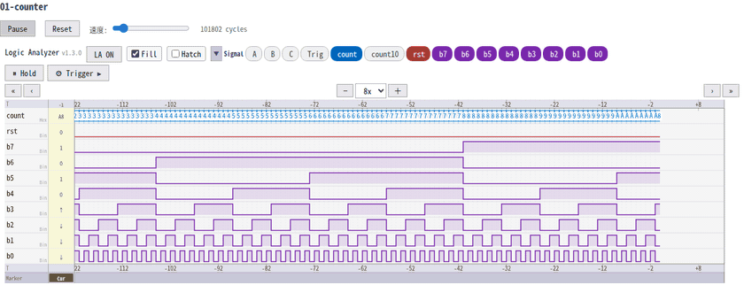

*Live waveforms from a Verilog binary counter: 8 register bits sampled every clock cycle and rendered at 60 Hz in the browser (captured 2026-10-21, Logic Analyzer v1.3.0). [Try it live ▶](https://tommie-jp.github.io/soft-fpga/01-counter/)*

## Live demo

**[https://tommie-jp.github.io/soft-fpga/](https://tommie-jp.github.io/soft-fpga/)**

| Example | Subject | Highlights |
| --- | --- | --- |
| [01-counter](https://tommie-jp.github.io/soft-fpga/01-counter/) | Binary counter | Minimal ring buffer → TypedArray → Canvas pipeline |
| [02-traffic-fsm](https://tommie-jp.github.io/soft-fpga/02-traffic-fsm/) | Traffic-light FSM | State Diagram highlighting the live state |
| [03-uart](https://tommie-jp.github.io/soft-fpga/03-uart/) | UART transceiver (loopback) | Start / data / stop bits and the TX / RX state machines |
| [04-6502](https://tommie-jp.github.io/soft-fpga/04-6502/) | Apple-I / 6502 | Interactive wozmon → Integer BASIC, microsequencer state |
| [05-dormann](https://tommie-jp.github.io/soft-fpga/05-dormann/) | 6502 Dormann test | Klaus Dormann's functional test running to completion on the RTL |
| [06-8080](https://tommie-jp.github.io/soft-fpga/06-8080/) | Intel 8080 / CP/M 2.2 | MBASIC, BDS C, Turbo Pascal 3, I/O Bus Analyzer |
| [09-pdp11](https://tommie-jp.github.io/soft-fpga/examples/09-pdp11/web/) | PDP-11 / Unix V6 | Unix V6 boot, MMU panel, disassembly, timing diagrams for all 63 instructions |
| [91-pong](https://tommie-jp.github.io/soft-fpga/91-pong/) | Pong (no CPU) | Counters and comparators only. One pixel per clock, with sound, playable on phones |

## Subject selection criteria

- **Historically significant architecture** — CPUs and circuits that changed industry or culture in their era
- **Proven Verilog source available** — verified RTL obtainable (decap-derived, MiSTer implementations, etc.)
- **Fun for me (tommie.jp)** — satisfying to build, exciting to run

## Visualization library: rtlscope

A library for declaratively observing RTL internal signals in the browser. The C++ harness writes every clock cycle into a ring buffer; JS reads it zero-copy through a TypedArray view and renders at 60 Hz.

| Layer | Role |
| --- | --- |
| C++ harness ([`cxx/`](cxx/)) | Sample every clock cycle into a ring buffer |
| JS rendering ([`js/`](js/)) | Zero-copy read via TypedArray view, 60 Hz canvas rendering |

The JS centerpiece is the Logic Analyzer shared by every example, [`js/rtlscope-la.js`](js/rtlscope-la.js) (v1.3.0): expression triggers with presets, Hold / Resume, and signal-name tooltips (full names in Japanese and English). The spec is in [docs/91](docs/91-rtlscope-la-LogicAnalyzerライブラリ.md) (Japanese).

## Architecture

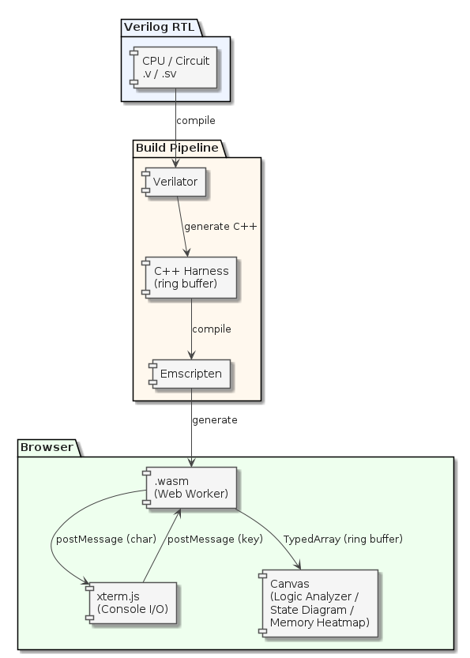

## Gallery

| 01-counter | 02-traffic-fsm | 04-6502 Woz Monitor | 04-6502 Integer BASIC |
| --- | --- | --- | --- |
| [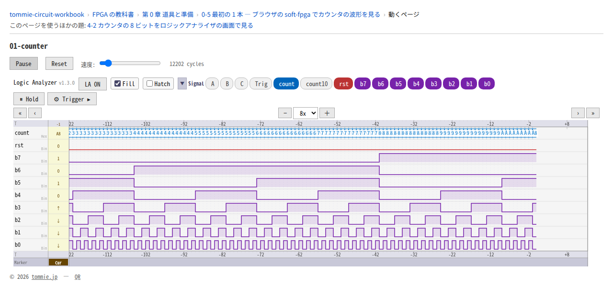](docs/img/ss/01-counter.png) | [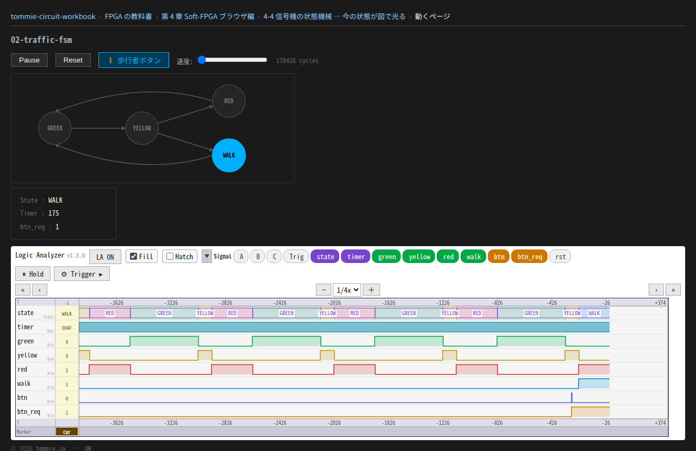](docs/img/ss/02-traffic-fsm.png) | [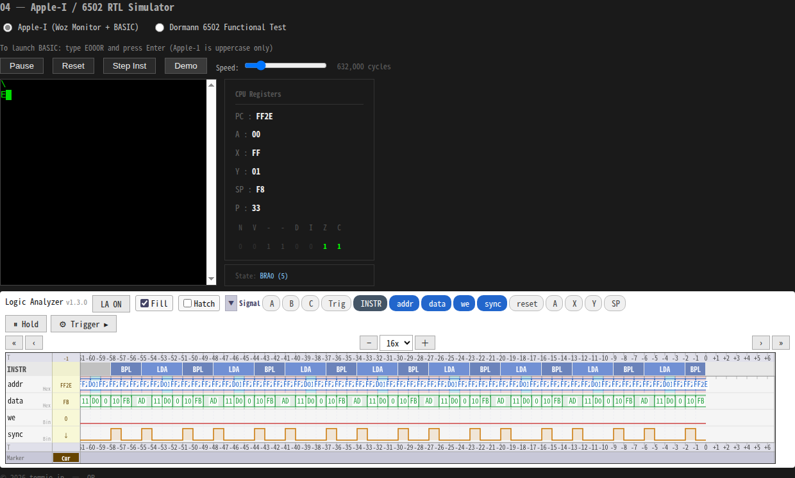](docs/img/ss/04-6502-wozmon.png) | [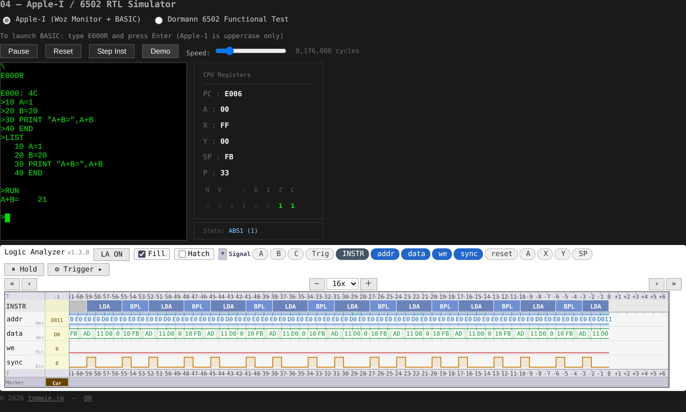](docs/img/ss/04-6502-basic.png) |
| 8-bit counter waveforms in Logic Analyzer | FSM state highlighted in real time | 6502 CPU registers and bus signals live | Integer BASIC running on the simulated 6502 |

### Animated captures

**02 — Traffic-light FSM** — a 3-phase signal with a pedestrian button. The State Diagram highlights the live state (`GREEN`→`YELLOW`→`RED`→`WALK`) while the logic analyzer shows the same transition on the output signals. [Open ▶](https://tommie-jp.github.io/soft-fpga/02-traffic-fsm/)

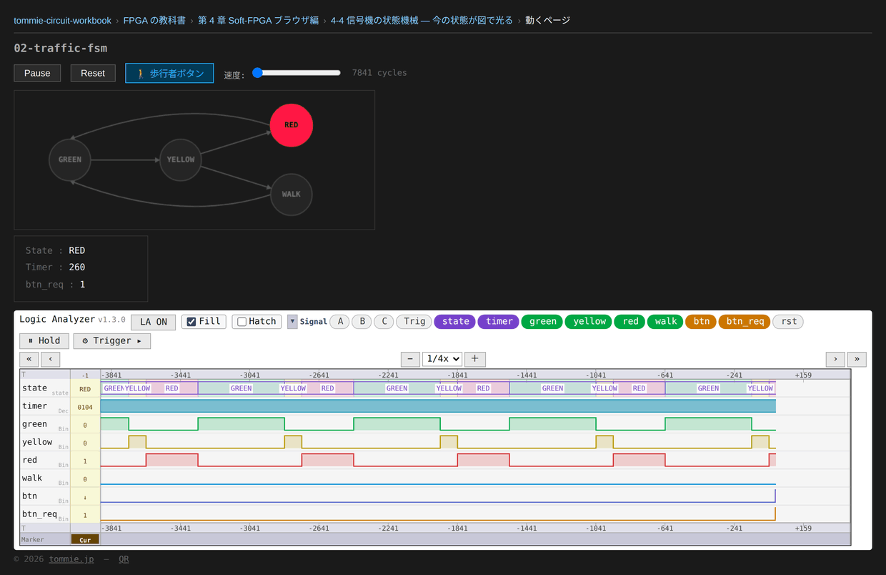

**03 — UART (loopback)** — transmitting `soft-FPGA` over the serial line: start / data / stop bits on `txd`/`rxd`, the TX and RX state machines, and the byte on the data bus, all sampled live. [Open ▶](https://tommie-jp.github.io/soft-fpga/03-uart/)

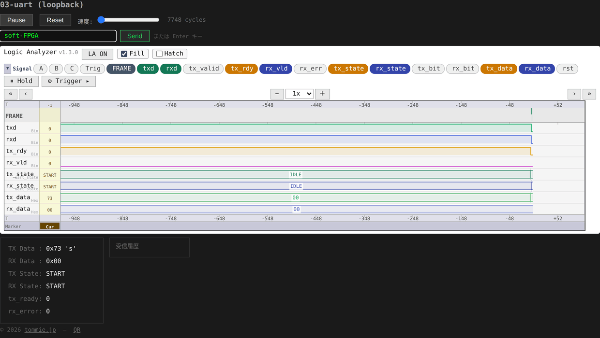

**04 — Apple-I / 6502** — Integer BASIC running on the 6502 RTL core: assigns `A=1`, `B=20`, evaluates `A+B = 21`, and exits. CPU registers, the **microsequencer state** (`JSR2`, `BRA0`, …) and the address / data / we / sync bus update every clock cycle — internal signals an instruction-level emulator does not have. [Open ▶](https://tommie-jp.github.io/soft-fpga/04-6502/)

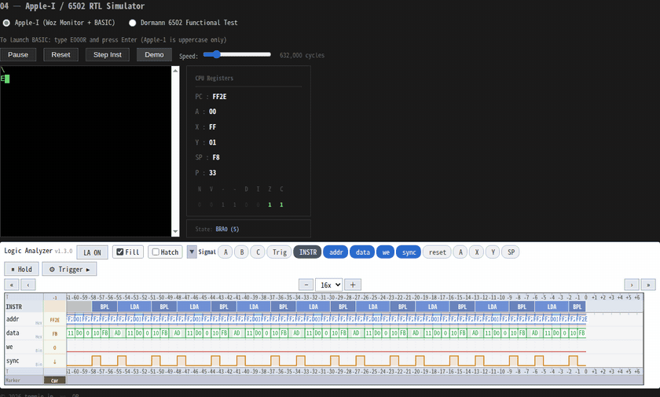

**06 — Intel 8080 / CP/M 2.2** — BDS C compile-run cycle on the vm80a (decapped-die) 8080 RTL under CP/M 2.2: `DIR` → `B:` → `TYPE HELLO.C` → `CC HELLO` → `CLINK HELLO` → `HELLO`. From source file to "Hello, CP/M!" in one session. CPU registers and the **I/O Bus Analyzer** update live throughout. [Open ▶](https://tommie-jp.github.io/soft-fpga/06-8080/)

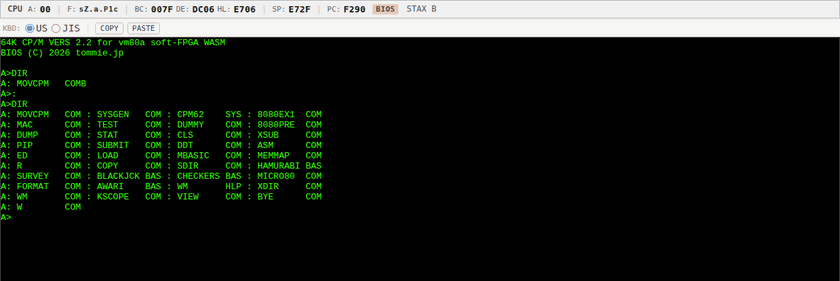

**09 — PDP-11 / Unix V6** — Unix V6 boots on Brad Parker's `cpus-pdp11` RTL, and `ed`, `cc` and `db` work from the Thompson shell. The MMU PAR/PDR registers, R0–R5/SP, a disassembly and the bus cycles are observable in the Logic Analyzer, with timing diagrams for all 63 instructions. [Open ▶](https://tommie-jp.github.io/soft-fpga/examples/09-pdp11/web/)

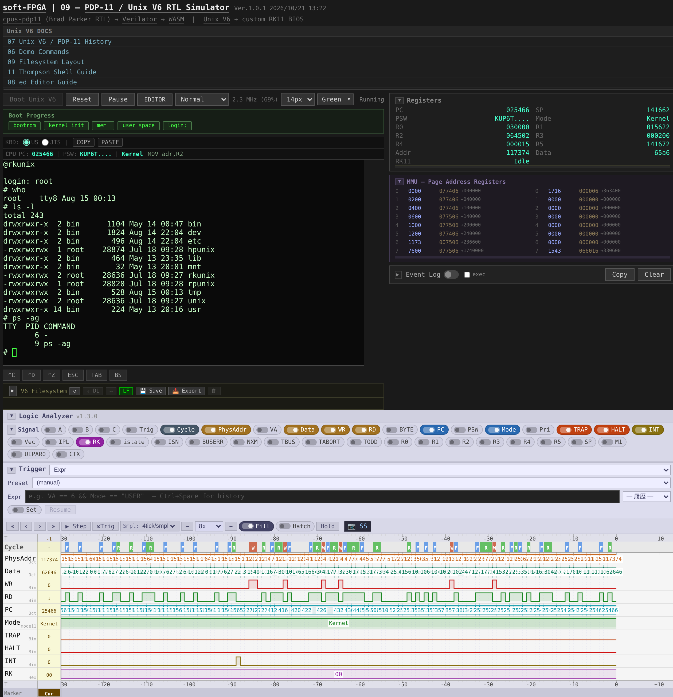

**91 — Pong (no CPU)** — in the spirit of the 1972 original, counters and comparators alone draw a 160 × 120 display at one pixel per clock. Ball, paddle, score and hit signals are visible in the Logic Analyzer while you play. The sound is one bit of the vertical counter fed straight to the speaker. The circuit is explained in the textbook chapter [12-3 "Pong — a game made of gates only"](https://github.com/tommie-jp/tommie-circuit-workbook/blob/main/06-fpga/12-projects/03-pong.md) (Japanese). [Open ▶](https://tommie-jp.github.io/soft-fpga/91-pong/)

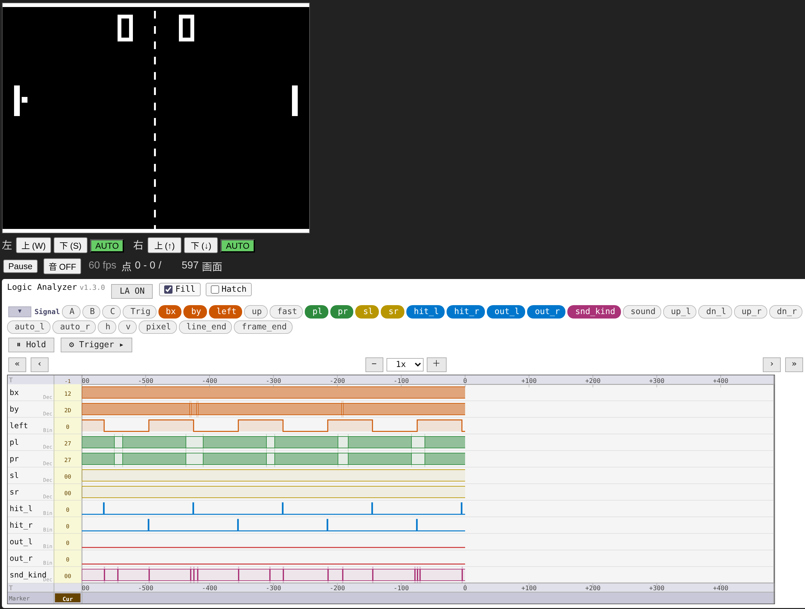

## Real hardware (Pico 2)

The same RTL also runs on a Raspberry Pi Pico 2 (RP2350), not only in the browser.

- [`firmware/`](firmware/) — Pico SDK firmware that runs the Verilator-generated Apple-I (6502 + wozmon + Integer BASIC) on the Pico 2. core1 runs the simulation; core0 handles the console and an LED panel that shows the bus signals on GPIO. Comes with host unit tests and hardware-in-the-loop tests ([`verif/hil`](verif/hil)).
- [`examples/07-pico2-web-serial`](examples/07-pico2-web-serial/) — a browser oscilloscope that reads the Pico 2 ADC over Web Serial.
- A live demo is planned for a homebrew-CPU meetup on 2026-11-28. The plan is in [docs/07](docs/07-Pico2実機デモ構想%282026-11-28自作CPU勉強会%29.md), the talk outline in [docs/08](docs/08-発表構成案%282026-11-28自作CPU勉強会%29.md), and the handout in [docs/08-pamphlet](docs/08-pamphlet/) (all Japanese).

## Design notes — what made this hard

A few non-obvious problems behind the "just run RTL in the browser" pitch. Full write-up in [docs/01-soft-FPGA-WebAssembly-設計議論メモ.md](docs/01-soft-FPGA-WebAssembly-設計議論メモ.md) (Japanese).

- **Never cross the Wasm↔JS boundary every cycle.** A per-cycle `EM_ASM`/`EM_JS` callback collapses under call overhead. rtlscope writes each sample into a ring buffer in Wasm memory; JS reads it zero-copy through a `TypedArray` view over `HEAP8.buffer` and renders at 60 Hz with `requestAnimationFrame`.
- **`ALLOW_MEMORY_GROWTH=1` silently invalidates those views.** When the Wasm heap grows, the old `ArrayBuffer` is detached and the view goes blank mid-run, so the JS never holds on to a view: it re-reads `Module.HEAPU32` on every frame before reading. Examples that run in a Web Worker copy the ring buffer with `slice()` inside the worker and post it.
- **Verilator hierarchical signal names are not stable.** `top->cpu__DOT__regs__DOT__pc` shifts with the Verilator version and `--public-flat-rw` is brittle. Observed signals are pulled out through a thin Verilog wrapper at the top level and bound in the C++ harness, so the JS side never depends on internal naming.
- **VCD dump is a non-starter in Wasm** — the in-Wasm filesystem fills instantly, so all tracing goes through the custom ring buffer instead.
- **The simulation runs in a Web Worker.** On the main thread the UI freezes. Examples 02, 03, 04, 06 and 09 already run in a worker, with the shared worker-side code in [`js/sft-la-worker-core.js`](js/sft-la-worker-core.js) (01 and 05 are still on the main thread). The fast path needs `SharedArrayBuffer` + Atomics, which pulls in COOP/COEP headers.
- **The core claim, precisely:** an instruction-level emulator has no T-states, microsequencer, or combinational-propagation signals to expose — not hidden, *absent*. soft-FPGA runs the circuit, so those signals exist and can be observed (see the 6502 capture above).

## Roadmap

| Phase | Subject | Goal | Status |
| --- | --- | --- | --- |
| Basic 1 | Binary counter | Minimal ring buffer → TypedArray → Canvas pipeline | ✅ Done |
| Basic 2 | Traffic light FSM | State Diagram view debut | ✅ Done |
| Basic 3 | UART transceiver | Logic Analyzer view in action | ✅ Done |
| CPU #1 | 6502 / Apple-I | Interactive experience (wozmon → Integer BASIC), Dormann functional test | ✅ Done |
| CPU #2 | 8080 / CP/M 2.2 | CP/M 2.2 + BDS C compiler on vm80a RTL | ✅ Done |
| CPU #3 | PDP-11 / Unix V6 | Unix V6 boot on `cpus-pdp11` RTL, MMU panel, timing diagrams for every instruction | ✅ Done |
| Game | Pong | Discrete-logic visualization showcase, paired with textbook chapter 12-3 | ✅ Done |
| Hardware | Apple-I on Pico 2 | Run the same RTL on real hardware with bus signals on LEDs | 🔧 In progress (for the 11/28 meetup) |
| Game | Breakout | Reuse the Pong video / audio path | 🔲 Planned |
| Basic 4–10 | LFSR / sequence detector / PWM / FIFO / SPI / I2C | Curriculum coverage | 🔲 Planned |
| CPU #4 | Z80 | Reuse the CP/M assets ([docs/07-z80](docs/07-z80/)) | 🔲 Planned |
| CPU #5 | MC6809 | Under investigation in [docs/08-mc6809](docs/08-mc6809/) | 🔲 Planned |
| CPU #6 | 4004 / Busicom | Definitive proof of visualization beyond instruction emulators | 🔲 Planned |

## Getting started

```bash
git clone https://github.com/tommie-jp/soft-fpga.git
cd soft-fpga
git submodule update --init
```

The submodules are the RTL for the 6502 (hoglet's `verilog-6502`), the 8080 (`vm80a`) and the PDP-11 (`cpus-pdp11`).

## Build

```bash
# Start the Docker dev environment
docker compose -f docker/compose.yml run --rm dev

# Native Linux simulation
scripts/build-host.sh
scripts/build-host-09.sh    # PDP-11

# WebAssembly build (per example)
scripts/build-wasm.sh       # → examples/01-counter/web/
scripts/build-wasm-06.sh    # → examples/06-8080/web/sim.js, sim.wasm
scripts/build-wasm-09.sh    # → examples/09-pdp11/web/
scripts/build-wasm-91.sh    # → examples/91-pong/web/

# Local browser test (auto-rebuild if sources changed + HTTP server)
cd examples/06-8080/web && ./doStart.sh
# open http://localhost:8000/

# Deploy to GitHub Pages (all examples, or one by number)
scripts/doDeployPages.sh
scripts/doDeployPages.sh 09

# Pico 2 firmware
scripts/build-pico.sh       # build in Docker → firmware/build/*.uf2
scripts/flash.sh            # flash via Debug Probe

# Regenerate the README screenshots and GIFs (2x resolution, from the live pages)
.venv/bin/python3 scripts/gen-readme-ss.py --install
```

Details are in [docs/04](docs/04-docker-ビルド手順.md) (Docker) and [docs/05](docs/05-deploy-gh-pages.md) (Pages), both in Japanese.

## Test

```bash
scripts/test-unit.sh        # unit tests in verif/tb_unit (in Docker)
scripts/test-cocotb.sh      # cocotb + pytest
scripts/test-pdp11-v6.sh    # PDP-11: Unix V6 boot
scripts/test-fw-unit.sh     # Pico 2 firmware host unit tests
scripts/test-hil.sh         # Pico 2 hardware-in-the-loop tests
```

## Directory layout

| Path | Role |
| --- | --- |
| [`examples/`](examples/) | Circuit samples (each has verilog / cxx / web) |
| [`web/`](web/) | Root index page for GitHub Pages |
| [`cxx/`](cxx/) | Shared C++ harness headers (libRTLScope) |
| [`js/`](js/) | JS shared by every example (Logic Analyzer, triggers, worker core, xterm helpers) |
| [`firmware/`](firmware/) | Pico 2 (RP2350) firmware |
| [`verif/`](verif/) | Verification (cocotb / native / Dormann / HIL) |
| [`vendor/`](vendor/) | External RTL submodules (`cpus-pdp11`) |
| [`scripts/`](scripts/) | Build, deploy, and test helper scripts |
| [`docker/`](docker/) | Dev environment (Ubuntu 24.04 + Verilator + Emscripten + cocotb) |
| [`docs/`](docs/) | Design documents (Japanese; index in [docs/00-目次.md](docs/00-目次.md)) |

## Related

- [`docs/01-soft-FPGA-WebAssembly-設計議論メモ.md`](docs/01-soft-FPGA-WebAssembly-設計議論メモ.md) — design policy, roadmap, library ideas
- [`docs/91-rtlscope-la-LogicAnalyzerライブラリ.md`](docs/91-rtlscope-la-LogicAnalyzerライブラリ.md) — Logic Analyzer library spec
- [tommie-circuit-workbook](https://github.com/tommie-jp/tommie-circuit-workbook) — the textbook. The live pages 01, 02, 03, 04, 06 and 91 carry a header showing their place in the textbook, so each chapter opens its page

## License

MIT
