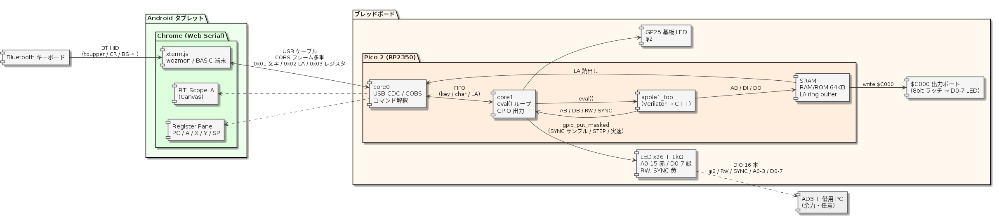

# Pico 2 実機デモ構想(2026-11-28自作CPU勉強会)

自作CPU勉強会で、実在 CPU の Verilog ソースを Raspberry Pi Pico 2 (RP2350) 実機で動かして見せるデモの構想メモ。
どの CPU を、どの順で、何を見せるかを決める。

## 1. 決定事項

| 順 | ターゲット | 状況 |
| --- | --- | --- |
| 1 | **6502 / Apple‑1**（wozmon → Integer BASIC） | 最優先。まずこれを Pico 2 で動かす |
| 2 | **8080 / CP/M 2.2** | 6502 の次。足回りを流用して移植する |
| — | Z80 | **やらない**（間に合わないため見送り） |
| — | PDP‑11 / Unix V6 | Pico 2 では対象外。WebAssembly 版が担当 |

## 2. 結論

Pico 2 実機デモには 6502 / Apple‑1 が最適で、次点が 8080 / CP/M である。
評価軸は歴史的意義・注目度・わかりやすさ・Pico 2 での実現性。

## 3. 候補の比較

| 候補 | 歴史的意義 | 注目度 | わかりやすさ | Pico 2 適性 | 備考 |
| --- | --- | --- | --- | --- | --- |
| **6502 / Apple‑1** | ◎ Woz/Jobs、Apple 創業機 | ◎ 一般層にも通じる | ◎ 信号が少ない（A0‑15, D0‑7, RW, SYNC, φ2）、ROM 256B の wozmon | ◎ RAM 数十 KB、コアが小さい。実効 100〜300 kHz 見込み（未測定） | 既存 04 のハーネスを流用。ディスクなし |
| **8080 / CP/M** | ◎ 最初の普及マイコン、CP/M → MS‑DOS の源流 | ○ | ○ | ○ ディスク約 1 MB を Flash XIP 化する設計が要る | 「Pico で CP/M が立つ」のインパクトは大きいが実装量は 6502 の 2〜3 倍 |
| PDP‑11 / Unix V6 | ◎◎ Unix と C の生誕地 | ◎ | △ MMU・18bit バスで複雑 | ✕ RAM ギリギリ、ブート 5〜15 分の見込み | Wasm 版の独壇場 |
| Z80 | ○ | ◎ 国内では PC‑88 / MSX / GB で最強 | ○ | △ tv80 / A‑Z80 はコアが大きく Pico で重い。未実装 | 8080 と話題が被る |
| 6809 | ○ | △ | ○ | ○ | 技術的に良い CPU だが一般受けしない |

## 4. 6502 / Apple‑1 を最初にする理由

1. **実効速度が実機クロックに近い。**
   Verilator on x86 で 13.7 MHz 相当（[04-6502/13](04-6502/13-テスト結果-ベンチマーク.md)）。
   Cortex‑M33 @150 MHz では 100〜300 kHz 程度と見込む。Apple‑1 は 1.023 MHz なので、wozmon → Integer BASIC の対話は体感十分。
   8080 / PDP‑11 はこの比率がさらに悪化する。
2. **実機ならではの演出を足せる。**
   6502 のバスは約 26 本で、Pico の GPIO 数とほぼ一致する。
   内部バス信号を GPIO に出せば、本物のロジアナやオシロで観測でき、アドレスバスを LED で光らせることもできる。
   Wasm 版（Canvas の Logic Analyzer）との対比で、本プロジェクトの核心「同じ RTL がブラウザでも実機でも動き、どちらでも内部信号が見える」を一番素直に見せられる。
3. **物語が 1 文で済む。**
   「1976 年の Apple‑1 を Verilog で書いた CPU が、1000 円の Pico の中で動いている」。
   聴衆を選ばず、説明コストが低い（背景は [04-6502/02](04-6502/02-Apple-I-歴史的価値.md)）。
4. **実装リスクが最小。**
   ディスクなし。ROM は配列化するだけ。
   [07-pico2-web-serial](../examples/07-pico2-web-serial) の USB‑CDC + Web Serial 経路をそのまま使える。

## 5. 8080 / CP/M を 2 番目にする理由と注意

- 「OS が立ち上がる」感動は 6502 より大きく、MS‑DOS につながる歴史の話もできる。
- 一方でディスク戦略（Flash XIP + ダーティセクタキャッシュ）が必須で、速度も体感で遅めになる。
- 6502 で足回りを固めてから移植するのが安全な順序。

8080 / CP/M の設計判断・実装フェーズ・スケジュール・シナリオは本メモから分離し、
[06-8080/70-Pico2実装計画](06-8080/70-Pico2実装計画.md) にまとめた。本メモの §9 以降は 6502 だけを扱う。

## 6. 構成案

| 項目 | 案 |
| --- | --- |
| コア分担 | core0: USB‑CDC / COBS、core1: `eval()` ループ |
| Logic Analyzer | リングバッファは SRAM 上で小さく取り、COBS で USB‑CDC に流す。ブラウザ側の `RTLScopeLA` で描画（[91](91-rtlscope-la-LogicAnalyzerライブラリ.md)） |
| フロントエンド | Web Serial のブラウザアプリ（07 の実績流用。Chromium 系のみ） |
| 実機演出（余力） | PIO / GPIO にバス信号を出し、実物の計測器や LED で見せる |

## 7. 見送りと理由

- **Z80**: 注目度は高いが、tv80 / A‑Z80 はコアが大きく未実装で、勉強会までに間に合わない。
  6502 と 8080 が動いた後に「CP/M 資産を Z80 でも」という形で続ける余地は残す（調査は [07-z80](07-z80/01-Z80-Verilogコア調査.md)）。
- **PDP‑11 / Unix V6**: エミュレート RAM に使える SRAM が 200〜300 KB 程度しかなく、ブートに 5〜15 分かかる見込み。
  デモ向きではない（詳細は [09-PDP11/01](09-PDP11/01-PDP11-verilogコア調査.md) §4.3）。
- **6809**: 技術的には面白いが一般受けしない（[08-mc6809](08-mc6809/01-MC6800-MC6809-Verilog調査と計画.md)）。

## 8. 未確定・要確認

- Pico 2 上の実効シミュレーション速度は未測定。6502 の最初のビルドで実測し、[04-6502/13](04-6502/13-テスト結果-ベンチマーク.md) に追記する。
  10 kHz を切ると BASIC の応答が苦しいので、実測後に §9.3 の表示モードを確定する。
- ~~GPIO にバス信号を出す場合の本数と PIO の割り当て~~ → §9.2 で確定（26 本 + GP25、PIO 不要）。
- ~~勉強会当日の持ち時間と、見せる順序~~ → 対面デモのみ・約 30 分（発表とは別枠）。順序は §10。
- タブレット + Chrome + Bluetooth キーボードの一式で、大文字化・BS・Ctrl‑C・改行が通るかの実機確認（§9.4）。

## 9. 6502 デモの構成（2026‑10‑12 検討）

### 9.1 前提

- 対面デモのみ。会場スクリーンへの投影はしない。持ち時間は約 30 分で、勉強会の発表とは別枠。
- 見せる相手は手元に集まった数人。LED と端末が肉眼で読める距離を前提にする。
- 入力はタブレット側の Bluetooth キーボードだけ。Pico 2 には押しボタンを付けない（GPIO を使い切るため）。

### 9.2 構成図と GPIO 割り当て



Pico 2（無印）のヘッダに出ている GPIO は GP0〜22 と GP26〜28 の 26 本。6502 のバスはちょうど収まる。

| 信号 | 本数 | 割り当て | LED 色 |
| --- | --- | --- | --- |
| A0〜A15 | 16 | GP0〜15 | 赤 |
| D0〜D6 | 7 | GP16〜22 | 緑 |
| D7 / RW / SYNC | 3 | GP26 / GP27 / GP28 | 緑 / 黄 / 黄 |
| φ2 | 1 | GP25（基板上の緑 LED） | — |

- φ2 は 27 本目になるので基板 LED に出す。Pico 2 W は GP25 が無線チップ用でこの手が使えない。無印を使う。
- LED は 1 kΩ 直列で約 1.4 mA/個、26 個で約 36 mA。USB 給電のままで足りる。抵抗は SIP アレイ、LED はバーグラフにすると配線が減る。
- 更新は `gpio_put_masked`（SIO 直書き）で足りる。エッジが 300 kHz 以下なので PIO は使わない。
- データバスは表示専用なので出力固定でよい。実機バスのような方向制御は要らない。

### 9.3 LED で「見える」ようにする仕掛け

100〜300 kHz で走る信号は、LED では「薄く点いたまま」にしか見えない。表示側に 3 つのモードを持たせる。

| モード | 動作 | 使う場面 |
| --- | --- | --- |
| **SYNC サンプル** | SYNC=1（命令フェッチ）のサイクルだけ LED を更新する | 実速度のまま「いまどの番地の何の命令か」を読む。既定モード |
| **STEP / SLOW** | 1 命令ごとに停止、または 1〜5 Hz に落とす | wozmon で打った数命令を目で追う。Apple‑1 のフロントパネル風 |
| **出力ポート `$C000`** | 書き込みで 8 bit をラッチし D0‑7 の LED に出す | `POKE` の結果を保持して見せる |

`$C000` は現行メモリマップ（[04-6502/52](04-6502/52-メモリマップ.md)）で未使用。
RAM への書き込みはバスに 1 サイクルしか現れないので、ラッチがないと `POKE` は LED に残らない。

- wozmon: `C000: 55`
- Integer BASIC: `POKE -16384, 85`（16 bit 符号付きなので `$C000` は `-16384`）
- 実機 Apple‑1 にはない拡張なので、聴衆にはその旨を断る。

モード切替・リセット・クロック固定（§9.5）は、USB シリアル上のエスケープ列 `Ctrl‑]` に続く 1 文字で受ける。実装したコマンドは次のとおり。

| キー | 区分 | 動作 |
| --- | --- | --- |
| `g` | 実行 | 実速（既定）。1000 サイクルずつまとめて回す |
| `w` | 実行 | 低速 4 Hz。1 サイクルずつ進め、φ2 の点滅が目で追える |
| `c` | 実行 | 固定クロック 10 kHz。オシロのトリガが安定する |
| `n` | 実行 | 次の命令まで進めて止まる。押すたびに 1 命令（ステップ実行に入る） |
| `y` | 表示 | SYNC サンプル + バス表示（既定） |
| `a` | 表示 | 全サイクル + バス表示（harness が見せるバスそのまま。D は 1 サイクル遅れる） |
| `o` | 表示 | D の LED をポート（`$C000`）の値にする |
| `t` | 表示 | 全 LED の自己診断（1 本ずつ流して全点灯、約 2 秒。この間シミュレーションは止まる） |
| `r` | 本体 | リセット（実速・SYNC サンプルに戻る） |
| `i` | 本体 | ビルド情報（`+XI`） |
| `b` | 本体 | 実効クロックの実測（`+XB`。実速で回した分だけを数える） |

表示の決まり方（`firmware/common/panel_logic.h`）:

- SYNC サンプルでは A に命令の番地（`pc - 1`）、D に命令コードを出す。実 RTL で、SYNC 時の `ab` は命令の**次**の番地、`db` が命令コードであることを ROM と突き合わせて確認した。
- RW・SYNC・φ2 は毎サイクル更新する。RW は読み出しで点灯。
- `$C000` への書き込みがあると D は自動でポートの値に切り替わり、保持する。バスの値に戻すには `y` か `a`（リセットでも戻る）。
- Debug Probe の UART ブリッジを使うビルド（`APPLE1_DEBUG_UART=ON`）では GP0 / GP1 を UART に使うため、A0 / A1 の LED は点かない。LED パネルを組んだら OFF で焼く。

### 9.4 タブレット側: 端末と Logic Analyzer を 1 ページにまとめる

**Android Chrome の Web Serial は動作実績がある**（tommieChat のオセロ機能で USB‑CDC 経由の通信を確認済み）。
これを前提に、タブレット側は Chrome の 1 ページに xterm.js と RTLScopeLA を同居させる。

**端末アプリと Chrome は同時に使えない。** USB‑CDC のポートを開けるのは 1 プロセスだけなので、
ネイティブの端末アプリと Chrome の Web Serial は排他になる。
04‑6502 の Web 版はすでに xterm.js + Logic Analyzer + Register Panel を 1 ページに持っているので、
Worker との `postMessage` を Web Serial の読み書きに差し替えるのが最短。

| 方向 | 内容 | フレーム |
| --- | --- | --- |
| Pico → Chrome | 端末出力 1 文字 | `0x01` + char |
| Pico → Chrome | LA サンプル（ring buffer のまとめ出し） | `0x02` + 長さ + 4 byte × N |
| Pico → Chrome | レジスタスナップショット | `0x03` + PC / A / X / Y / SP / P |
| Chrome → Pico | キー入力 | `0x81` + char |
| Chrome → Pico | 制御（モード・リセット・STEP・LA キャプチャ要求） | `0x82` + cmd |

フレームは [07-pico2-web-serial](../examples/07-pico2-web-serial) と同じ COBS で区切る。

LA は連続ストリームにしない。1 サンプル 4 byte（A16 + D8 + RW + SYNC + φ2）を 200 kHz で流すと 800 KB/s になり、
USB Full‑Speed CDC の実効（約 500 KB/s 前後）を超える。
AD3 のシングルショットと同じ発想で、SRAM の ring buffer（例: 4096 サンプル = 16 KB）をトリガか要求で止めて一括送信する。
転送は 30 ms 程度で終わる。これが AD3 の代替になる。

キーボード周りでファーム側がやること:

- 小文字 → 大文字変換（wozmon は大文字のみ）
- CR / LF → CR
- BS / DEL → `_`（Apple‑1 のラブアウト）
- `Ctrl‑C`（0x03）はそのまま通す（BASIC の中断）

Bluetooth キーボードは Chrome では通常の `keydown` として届く。JIS 配列なら [94](94-xterm-jp106-キーボードライブラリ.md) を流用する。
タブレットの USB ポートは 1 つなので、デモ中に充電するなら PD 対応ハブが要る。

TinyUSB で CDC を 2 本出して端末アプリと Chrome に分ける案は**不採用**（タブレットの USB は 1 ポートで、分ける意味がない）。

### 9.5 AD3 の扱い

WaveForms は Windows / Mac / Linux 用で、Android 版も単体動作もない。ノート PC がない以上、AD3 は主役から外す。

1. §9.4 の RTLScopeLA を「ロジアナ」として見せる。これが本命。
2. 参加者の PC を借りる。WaveForms は USB を挿すだけで動くので、手順書（接続 → ch 設定 → φ2 でトリガ）を用意しておけば 2 分で立つ。
3. 使う場合は DIO 16 本に絞る（φ2 / RW / SYNC / A0‑3 / D0‑7 など）。φ2 を GP25 に出す案だとプローブできないので、AD3 を使うなら φ2 をヘッダ上のピンに移し、代わりに D7 を外す。
4. フリーランでは周期が揺れてトリガが不安定になる。**固定クロック**（`Ctrl‑]` `c`、10 kHz 一定）にすると波形が安定する。

## 10. 当日のシナリオ案（約 30 分）

| # | 目安 | 操作 | 見える物 |
| --- | --- | --- | --- |
| 1 | 3 分 | 電源投入。Chrome でポートを開き、wozmon の `\` が出る | 端末 + φ2 の点滅 |
| 2 | 5 分 | `300: A9 55 8D 00 C0 4C 00 03` → `300R` | SYNC サンプルで A=0300→0302→0305 を繰り返す。`$C000` への書き込みで D0‑7 がポートの値 `01010101` に切り替わり固定（実 RTL で確認済み） |
| 3 | 5 分 | `Ctrl‑]` `y` でバス表示に戻し、`Ctrl‑]` `n` を押すたびに 1 命令進める | 命令フェッチごとに A / D が変わる。Register Panel の PC が追従 |
| 4 | 5 分 | `Ctrl‑]` `g` で実速度に戻し `E000R` → `PRINT 2+2` → 短い `FOR` ループ | 上位アドレス LED がほぼ固定、下位が揺らぐ |
| 5 | 3 分 | `POKE -16384, 170` → `PRINT PEEK(-16384)` | D の LED が自動でポート表示になり `10101010` で保持される |
| 6 | 5 分 | LA キャプチャ要求 → RTLScopeLA で φ2 / RW / SYNC / AB を見る | タブレット上のロジアナ波形。Wasm 版と同じ画面 |
| 7 | 余力 | 借りた PC があれば AD3 で φ2 / RW | 本物の矩形波 |

手順 2〜3 と 4〜6 のどちらかを削れる構成にしておく。聴衆が入れ替わるなら 1→2→5 の短縮版（10 分）を繰り返す。

## 11. 事前に検証すること

- 実効速度の実測（§8）。
- core0 で USB を回しながら core1 で `eval()` を回したときの φ2 の安定度。
- タブレット + Chrome + Bluetooth キーボードで、大文字化・BS・Ctrl‑C・改行・`Ctrl‑]` エスケープが通ること。
- LA 一括送信（16 KB）の所要時間と、送信中に端末入力が詰まらないこと。
- Pico 2 無印の GP25 で φ2 が目視できる点滅になること（STEP / SLOW 時）。

## 12. 実装計画（2026‑10‑12 起草、当日まで 6 週半）

### 12.1 現状の足場と欠けているもの

| 資産 | 状態 | 扱い |
| --- | --- | --- |
| [04-6502/cxx/harness.cpp](../examples/04-6502/cxx/harness.cpp)（580 行） | ROM は配列化済み（`BASIC[4096]` / `WOZMON[256]`）。`fopen` は Dormann 用のみ。ring は `Ring<4096,2>` = 32 KB | **そのまま流用**。Dormann 部を `#ifndef PICO` で外す |
| [04-6502/cxx/main_linux.cpp](../examples/04-6502/cxx/main_linux.cpp)（92 行） | termios 依存 | `main_pico.cpp` に差し替える。キー変換ロジックは移植 |
| [cxx/verilated.cpp](../cxx/verilated.cpp) / `verilatedos_c.h` / `wasm_compat.h` | Wasm 向けに削った Verilator ランタイム | arm‑none‑eabi で通るか試す。通らなければ mutex / thread を stub する |
| [07-pico2-web-serial](../examples/07-pico2-web-serial) | Pico SDK CMake・`stdio_usb`・COBS エンコーダ（C）、Web 側の COBS デコード + `TransformStream` | コンソール経路と Web Serial 接続の雛形 |
| [04-6502/web](../examples/04-6502/web) | xterm.js + RTLScopeLA + `sft-6502-la-defs.js` + Register Panel | 画面はそのまま。Worker ブリッジを Web Serial ブリッジに置き換える |
| [firmware/CMakeLists.txt](../firmware/CMakeLists.txt) | **リバーシ（`~/29-soft-FPGA-reversi`）のコピー**。`othello_top` / `src/verilator-runtime` / `stub_mutex.h` / `cxx_minimal.cpp` を参照するが、本リポジトリに存在しない | 6502 用に書き直す。参照先は §12.1.1 のとおり持ち込む |
| [scripts/build-pico.sh](../scripts/build-pico.sh) / `flash.sh` / `doBuildPico.sh` / `test-hil.sh` | リバーシ由来。`docker/compose.yml` に `firmware` / `flash` / `test-hil` サービスが無く、Dockerfile に Pico SDK も無い（[docker/Dockerfile](../docker/Dockerfile) 冒頭） | `Dockerfile.pico` と compose サービスをリバーシから持ち込み、ターゲット名を直す |

#### 12.1.1 リバーシ側から持ち込むもの（2026‑10‑12 に読み取り確認）

`~/29-soft-FPGA-reversi` は Pico 2 + Verilator 5.048 のベアメタル化を一通り終えている。
Verilator のタグが本リポジトリと同じ v5.048 なので、そのまま使える。

| リバーシ側 | 持ち込み先 | 内容 |
| --- | --- | --- |
| `docker/Dockerfile` | `docker/Dockerfile.pico` | xPack arm‑none‑eabi‑gcc 15.2.1（apt の 13.2 は newlib 差でリンク不可）、Pico SDK 2.2.0、Raspberry Pi 版 OpenOCD（CMSIS‑DAP）、Verilator v5.048、bloaty。`PICO_BOARD=pico2` を ENV で固定 |
| `docker/compose.yml` の `firmware` / `flash` / `test-hil` | `docker/compose.yml` | `flash` は `/dev/bus/usb` をバインドして root 実行。`test-hil` は再列挙で ttyACM の番号が変わるため `/dev` 全体をバインド |
| `firmware/src/stub_mutex.h` | `firmware/common/verilator-runtime/` | `verilated_threads.h` / `verilated_trace.h` の include guard を先取りして潰し、`std::mutex` / `VlThreadPool` / `VerilatedTraceBaseC` / `clock_gettime` を no‑op で用意。**上流 `verilated.cpp` を無修正でリンクできる** |
| `firmware/src/verilator-runtime/verilated.cpp` | 同上 | 上流 5.048 から `<iostream>` / `<sstream>` を外したもの（Cortex‑M33 + newlib‑nano で約 300 KB 減）。本リポジトリの [cxx/verilated.cpp](../cxx/verilated.cpp) は Wasm 向けの別物なので**使わない** |
| `firmware/src/cxx_minimal.cpp` | `firmware/common/` | `__gxx_personality_v0` / `__cxa_pure_virtual` / `__cxa_demangle` を `__builtin_trap()` に置き換え、unwind と demangler（約 15 KB）を引かない。到達すると BKPT になり Debug Probe で捕まえられる |
| `firmware/CMakeLists.txt` の `add_*_firmware()` | `firmware/CMakeLists.txt` | configure 時に Verilator を実行し `file(GLOB)` で生成物を拾う形。`PICO_CXX_ENABLE_RTTI 1` / `EXCEPTIONS 0`、`-include stub_mutex.h -w` を Verilator 由来ソースだけに付ける。LTO は `--wrap=printf` と衝突するので不採用 |
| `firmware/src/main.cpp` | `firmware/apple1/main_pico.cpp` の雛形 | `getchar_timeout_us(0)` / `putchar_raw()` による生バイト入出力、`time_us_32()` での `eval()` 実測（`XB` 応答）、Flash / SRAM / clk / git hash の自己申告（`XI` 応答）。この 2 つは `Ctrl‑]` `b` / `i` として移植する |
| `scripts/_flash-inner.sh` / `wsl-attach.sh` / `wsl-attach.ps1` | `scripts/` | OpenOCD `program verify reset exit`。usbipd で Probe（2e8a:000c）だけを WSL に attach し、Pico 自身の CDC は Windows 側に残す運用 |
| `scripts/size.sh` | `scripts/` | ELF / UF2 のサイズ、シンボル上位、bloaty 差分。速度チューニング（Phase 5）で使う |
| `verif/tb_hil/conftest.py` / `requirements.txt` / `pytest.ini` | `verif/hil/` | セッション開始時に 1 回だけ Probe 経由でフラッシュし、pyserial で `dut` と `expect` を提供。`--no-flash` / `--port` あり |

本リポジトリの [firmware/README.md](../firmware/README.md) にある `-fno-rtti` は誤りで、リバーシ側の結論どおり RTTI は有効のままにする。

#### 12.1.2 Debug Probe の使い方

Debug Probe は SWD（SWCLK / GND / SWDIO の 3 線、Pico 2 のデバッグコネクタ）でつなぐ。**GPIO を消費しない。**

| 用途 | フェーズ | 経路 |
| --- | --- | --- |
| 書き込み | 全部 | `scripts/flash.sh` → OpenOCD。BOOTSEL は予備機への書き込み用 |
| クラッシュ捕捉 | 1〜4 | `cxx_minimal.cpp` の `__builtin_trap()` = BKPT。`gdb-multiarch` + OpenOCD で止まった場所を見る |
| デバッグログ / HIL | 0〜2 | Probe の UART ブリッジ（`/dev/ttyACM0`）。ファームの UART0 を GP0 / GP1 に出す |
| デモ当日 | 5 | 使わない。Pico の USB‑CDC はタブレットへ |

UART ブリッジは GP0 / GP1 を使うので、§9.2 の A0 / A1 と衝突する。
CMake オプション `APPLE1_DEBUG_UART`（既定 ON）で切り替え、Phase 3 で LED パネルを配線した後は OFF で焼く。
OFF のときの HIL は Pico 自身の CDC（2e8a:000a）を usbipd で attach して `--port` で指定する。

### 12.2 配置案

```text
firmware/
  CMakeLists.txt            ← 6502 用に書き直し。将来 8080 ターゲットを同じ関数で追加
  common/
    verilator-runtime/      ← リバーシの verilated.cpp（iostream 除去済み）+ stub_mutex.h
    cxx_minimal.cpp         ← リバーシから（personality / demangle の stub）
    cobs.c / cobs.h         ← 07 から移植
    console.cpp             ← USB-CDC ↔ multicore FIFO、キー変換、エスケープ列
  apple1/
    main_pico.cpp           ← core0: console / COBS、core1: eval ループ（雛形はリバーシの main.cpp）
    led_panel.cpp           ← GPIO 出力と表示モード
    config.h                ← GPIO 割り当て、ring サイズ、モード定数、APPLE1_DEBUG_UART
scripts/
  _flash-inner.sh / wsl-attach.{sh,ps1} / size.sh  ← リバーシから
verif/hil/
  conftest.py / requirements.txt / pytest.ini      ← リバーシの tb_hil から
  test_wozmon.py / test_basic.py                   ← 新規
examples/04-6502/
  cxx/harness.cpp           ← $C000 ラッチ、バス観測フック、Dormann の #ifndef
  web/pico.html             ← index.html の Worker ブリッジを Web Serial に置換した版
  web/js/sft-serial-bridge.js ← COBS フレーム ↔ xterm / LA / Register Panel
```

### 12.3 フェーズと粒度

半日〜2 日のタスクに切る。各フェーズの最後の行が完了条件。

#### Phase 0 — ビルド環境（目安 2 日）

| # | タスク | 成果物 |
| --- | --- | --- |
| 0‑1 | リバーシの `docker/Dockerfile` を `docker/Dockerfile.pico` として持ち込む（xPack arm‑gcc 15.2.1、Pico SDK 2.2.0、OpenOCD、Verilator v5.048）。イメージ名は `sfa-pico:local` | イメージ |
| 0‑2 | `compose.yml` に `firmware` / `flash` / `test-hil` サービスを足す（リバーシの定義を名前だけ直して転記）。`build-pico.sh` / `flash.sh` / `doBuildPico.sh` のターゲット名を `apple1` に直し、`_flash-inner.sh` と `wsl-attach.*` を持ち込む | `scripts/build-pico.sh` が通る |
| 0‑3 | `firmware/CMakeLists.txt` を書き直し、`add_apple1_firmware()` で Verilator → arm ビルド。`common/` に `stub_mutex.h` / `verilated.cpp` / `cxx_minimal.cpp` を置く（まだリンクはしない） | `firmware/build/apple1.uf2` |
| 0‑4 | Hello: GP25 点滅 + USB‑CDC エコー + UART0 にも同じ出力。`scripts/wsl-attach.sh` → `scripts/flash.sh` で Probe 経由書き込み。予備機は BOOTSEL で | タブレットの端末アプリでエコーが返る |
| 0‑5 | `verif/hil/` をリバーシの `tb_hil` から作り、`test_hello.py`（エコー 1 本）を Probe の UART ブリッジ経由で通す | `scripts/test-hil.sh` が通る |

完了条件: `scripts/build-pico.sh` → `flash.sh` → `test-hil.sh` が通り、Pico 2 がタブレットから見える。

#### Phase 1 — Verilator ベアメタル化と速度実測（目安 2 日）

| # | タスク | 成果物 |
| --- | --- | --- |
| 1‑1 | `Vapple1_top` + リバーシ由来ランタイムをリンクする。`-include stub_mutex.h -w` を Verilator 由来ソースだけに付ける。`-fno-exceptions`、RTTI 有効。`scripts/size.sh` で Flash / SRAM を記録 | リンク成功、サイズ表 |
| 1‑2 | `harness.cpp` の Dormann 部を `#ifndef PICO` で外し、`sim_init()` / `step()` を core1 で呼ぶ | wozmon の `\` が UART に出る |
| 1‑3 | リバーシ `main.cpp` の `XB` / `XI` を `Ctrl‑]` `b` / `i` として移植し、`time_us_32()` で 1 秒あたりのサイクル数を出す。`-Os` / `-O2` を比較 | 実効クロック [kHz] |
| 1‑4 | 結果を [04-6502/13](04-6502/13-テスト結果-ベンチマーク.md) に追記。10 kHz 未満なら SLOW モードを既定にするなど §9.3 を見直す | ベンチマーク表 |

完了条件: 実効クロックが数値で分かり、§9.3 の表示モード設計が確定する。

#### Phase 2 — コンソール（目安 3 日）

| # | タスク | 成果物 |
| --- | --- | --- |
| 2‑1 | `console.cpp`: リバーシと同じ `getchar_timeout_us(0)` / `putchar_raw()` で生バイト入出力（`pico_stdio` の CRLF 変換を切る）。`APPLE1_DEBUG_UART=ON` のときは UART0 にも同じコンソールを出す。core0 ← → core1 は `multicore_fifo` か SRAM 上のキュー | USB ↔ `send_key()` / `get_display_char()` |
| 2‑2 | キー変換（`toupper`、CR/LF → CR、BS/DEL → `_`、Ctrl‑C 通過）を `main_linux.cpp` から移植 | — |
| 2‑3 | エスケープ列 `Ctrl‑]` + 1 文字（`r` リセット、`s` STEP、`n` 次の命令、`f` 実速度、`c` クロック固定、`l` LA キャプチャ）。まず `r` だけ | コマンド表 |
| 2‑4 | **プレーンテキストモード**で wozmon → `E000R` → `PRINT 2+2` をタブレットの端末アプリから通す | — |
| 2‑5 | HIL: `test_wozmon.py`（`\` プロンプト、`FF00` でダンプ）と `test_basic.py`（`E000R` → `PRINT 2+2` → `4`）。Probe の UART ブリッジ経由（0‑5 の仕組み） | `scripts/test-hil.sh` |

完了条件: タブレット + 端末アプリ + Bluetooth キーボードで BASIC が使える。**この時点で最低限のデモが成立する**（LED なし）。

#### Phase 3 — LED パネルと表示モード（目安 3 日 + 工作）

| # | タスク | 成果物 |
| --- | --- | --- |
| 3‑1 | `harness.cpp` に `$C000` ラッチ（`memory_write`）と `get_out_port()` を追加。Wasm 版にも同じ挙動が出るので Web 側でも表示できる | — |
| 3‑2 | `harness.cpp` の `step()` 末尾にバス観測フック `sim_bus_observe(ab, db, we, sync)` を置く（weak、Linux / Wasm では空） | — |
| 3‑3 | `led_panel.cpp`: 実速 / SYNC サンプル / STEP / SLOW の 4 モード。`gpio_put_masked` で 26 本 + GP25 を更新 | モード切替が動く |
| 3‑4 | STEP モード: core1 が `step_instruction()` 後に停止し、`Ctrl‑]` `n` で 1 命令進む | — |
| 3‑5 | クロック固定モード: `step()` を一定周期（例: 10 kHz）で呼ぶ。AD3 を借りたとき用 | — |
| 3‑6 | 工作: ブレッドボード、LED バーグラフ × 3、SIP 抵抗、配線。写真を docs に残す | 実機 |
| 3‑7 | `APPLE1_DEBUG_UART=OFF` で焼き直し（GP0 / GP1 を A0 / A1 に明け渡す）。HIL は Pico の CDC を usbipd で attach して `--port` 指定に切り替える | OFF ビルドの UF2 |

完了条件: §10 の手順 2・3・5（`300R` の繰り返し、STEP、`POKE -16384,170`）が LED で読める。

#### Phase 4 — COBS 多重と Web ページ（目安 4 日）

| # | タスク | 成果物 |
| --- | --- | --- |
| 4‑1 | `cobs.c` を 07 から移植。フレーム種別 `0x01` 文字 / `0x02` LA / `0x03` レジスタ / `0x81` キー / `0x82` 制御を `console.cpp` に追加。起動時はプレーンテキスト、Web 側が `0x82 'B'` を送ったら COBS に切り替える（端末アプリでのフォールバックを残す） | プロトコル定義 |
| 4‑2 | LA キャプチャ: `ring` を freeze → 4096 × 2 word（32 KB）を `0x02` フレームで分割送信 → rearm。既存のトリガ API（`sim_set_edge_trigger` 等）は `0x82` 経由で呼ぶ | — |
| 4‑3 | `sft-serial-bridge.js`: Web Serial を開き、COBS デコード（07 の `COBSFrameSplitter` 流用）、種別で xterm / LA / Register Panel に振り分け。送信はキー・制御 | JS モジュール |
| 4‑4 | `pico.html`: `index.html` を複製し Worker ブリッジを 4‑3 に置換。ring のワード形式が Wasm 版と同一なので `sft-6502-la-defs.js` と RTLScopeLA はそのまま | ページ |
| 4‑5 | 定期レジスタ送信（例: 10 Hz、STEP 時は停止ごと）と `$C000` 表示 | — |
| 4‑6 | gh‑pages に `pico.html` を載せ、タブレットの Chrome から HTTPS で開けるようにする（`doDeployPages.sh` の対象に追加） | 公開 URL + QR |

完了条件: §10 の手順 6（タブレット上の RTLScopeLA に φ2 / RW / SYNC / AB の波形）が出る。

#### Phase 5 — 仕上げとリハーサル（目安 3 日）

| # | タスク | 成果物 |
| --- | --- | --- |
| 5‑1 | 速度チューニング（`-O2`、`eval()` 呼び出し削減、必要なら `set_sys_clock_khz` でのオーバークロック） | 更新したベンチマーク |
| 5‑2 | §10 のシナリオを通しで 2 回リハーサル。所要時間を表に書き戻す | 確定シナリオ |
| 5‑3 | 当日キット: 予備 Pico 2（書込み済み）、USB ケーブル 2 本、PD ハブ、モバイルバッテリ、AD3 用手順書 1 枚 | チェックリスト |
| 5‑4 | docs 更新: 本メモの §9〜§10 を実測値で修正、firmware/README の方針訂正、04-6502 の実装計画に Pico 節を追加 | — |

### 12.4 スケジュール案

| 週 | 期間 | フェーズ | マイルストーン |
| --- | --- | --- | --- |
| 1 | 10/13〜10/19 | Phase 0・1 | Probe で焼けて HIL が通り、実効クロックが分かる |
| 2 | 10/20〜10/26 | Phase 2 | **端末アプリで BASIC が動く（最低限のデモ成立）** |
| 3 | 10/27〜11/2 | Phase 3 | LED で命令の流れと `POKE` が見える |
| 4〜5 | 11/3〜11/16 | Phase 4 | タブレットの Chrome で端末 + RTLScopeLA |
| 6 | 11/17〜11/23 | Phase 5 | リハーサル完了 |
| — | 11/24〜11/27 | 予備 | 遅れの吸収 |

Phase 2 の終了を最初の「見せられる状態」にし、Phase 4 が間に合わなければ端末アプリ + LED で当日に臨む。
Phase 4 の順序は 4‑1 → 4‑3 → 4‑4（端末だけ COBS で動かす）→ 4‑2 → 4‑5 の順にし、LA は最後に足す。

### 12.5 リスクと逃げ道

| リスク | 兆候 | 逃げ道 |
| --- | --- | --- |
| Verilator ランタイムが arm で通らない | Phase 1‑1 で 1 日超える | リバーシ側は同じ v5.048 で通っている。差分は `Vapple1_top` 側だけなので、生成コードが新しく参照するシンボルを `stub_mutex.h` に足す |
| Flash / SRAM が足りない | `size.sh` で bss が 400 KB 超 | RAM 64 KB + ring 32 KB + モデルで 150 KB 前後の見込み。超えるなら ring を 2048 に半減 |
| 実効クロックが 10 kHz 未満 | Phase 1‑3 | SLOW / STEP 中心のシナリオに切り替え、BASIC は `PRINT` 程度に留める |
| Android Chrome で `requestPort()` が失敗する | Phase 4‑3 | tommieChat（24-mmo-Tommie-chat）で動いた接続コードを流用する。それでも駄目なら Phase 2 のプレーンテキストで当日に臨む |
| core0 の USB 処理で φ2 が揺れる | Phase 2‑1 | core1 は USB に触らず FIFO だけ。表示キューが詰まったら文字を捨てずに core1 を待たせる |
| GPIO 配線ミス | Phase 3‑6 | `Ctrl‑]` `t` で LED 全点灯 / 1 本ずつ歩くテストパターンを入れておく |

### 12.6 実装状況（2026‑10‑12）

Phase 0〜3 のうち、実機が要らない部分は済んだ。**実機での確認（Probe / Pico 2 が WSL2 に未接続）と、LED パネルの工作（3‑6）が残っている。**

| # | 内容 | 状態 | 備考 |
| --- | --- | --- | --- |
| 0‑1 | `docker/Dockerfile.pico` | 完了 | イメージ `sfa-pico:local`（2.5 GB、初回ビルド約 22 分） |
| 0‑2 | compose の `firmware` / `flash` / `test-hil`、各スクリプトの apple1 化 | 完了 | `scripts/doVersionUp.sh` はリバーシ専用（`rtl/proto.v` 前提）なので `doBuildPico.sh` から外した |
| 0‑3 | `firmware/CMakeLists.txt`（Verilator → arm） | 完了 | `scripts/build-pico.sh` が全ビルドで約 16 秒 |
| 0‑4 | `apple1_hello`（GP25 点滅 + エコー + `XI`） | ビルド済み・実機未確認 | |
| 0‑5 | `verif/hil/test_hello.py`（3 本） | 作成済み・実機未実行 | Probe の UART ブリッジ（`/dev/ttyACM0`）経由 |
| 1‑1 | `Vapple1_top` + リバーシ由来ランタイムのリンク | 完了 | `stub_mutex.h` の追加は不要だった |
| 1‑2 | `harness.cpp` の `fopen` を `#ifndef SFA_PICO` で除外 | 完了 | Linux のネイティブ回帰 `wozmon` は 24 PASS / 0 FAIL のまま |
| 1‑3 | `Ctrl‑]` `i` / `b` / `r`、実効クロック実測 | 実装済み・実測は実機待ち | |
| 2‑1 | core0 コンソール / core1 シミュレーション（`apple1/sim_core.cpp`） | ビルド済み・実機未確認 | pico_util の queue 4 本（キー・表示・コマンド・bench 応答） |
| 2‑2 | キー変換（`common/input_filter.h`）と表示変換（`common/display_filter.h`） | **完了** | ホスト単体テスト 20 ケース、`scripts/test-fw-unit.sh` |
| 2‑3 | `Ctrl‑]` コマンド（`i` / `b` / `r`） | 完了 | STEP / 固定クロックは Phase 3 |
| 2‑4 | タブレット + 端末アプリ + BT キーボードでの動作確認 | **実機待ち** | |
| 2‑5 | `verif/hil/test_wozmon.py`（4 本）/ `test_basic.py`（2 本） | 作成済み・**ホストで 6 本 PASS**・実機未実行 | 下記の検証方法 |
| 3‑1 | `$C000` 出力ポート | 完了（方針を変更） | harness は触らない。`PanelLogic` が `$C000` への書き込みをバスから検出して保持する（RAM が既に値を保持している） |
| 3‑2 | バス観測フック `sim_bus_observe()` | **完了** | `harness.cpp` に `#ifdef SFA_PICO` で 11 行。Wasm / Linux には影響しない |
| 3‑3 | LED パネル（`common/panel_logic.h` + `apple1/led_panel.cpp`） | ビルド済み・実機未確認 | SYNC サンプル / 全サイクル / ポートの 3 表示。単体テスト 14 ケース |
| 3‑4 | ステップ実行（`Ctrl‑]` `n`） | ビルド済み・ホストのシムで動作確認 | `common/run_control.h`。単体テスト 11 ケース |
| 3‑5 | 低速（`w`）・固定クロック（`c`） | 同上 | 時刻を引数にしたので、実機なしで時間経過を再現して試験できる |
| 3‑6 | ブレッドボード工作 | **未着手** | LED バーグラフ × 3、SIP 抵抗。`Ctrl‑]` `t` で配線を確認できる |
| 3‑7 | `APPLE1_DEBUG_UART=OFF` の UF2 | 未着手 | 配線後に焼く。A0 / A1 は OFF のときだけ点く |
| — | `verif/hil/test_control.py`（5 本） | 作成済み・ホストで 3 本 PASS | `i` / `b` の 2 本はシムが未実装のため実機待ち |

計画からの変更点:

- Phase 1 は単一コアで始めたが、Phase 2 で core1 に移した。harness の static 変数（RAM・Verilator モデル・キュー）は core1 だけが触り、core0 とは queue 経由でのみ連携する。core1 のスタックは Verilator の `eval()` を見込んで 16 KB 確保した（SDK 既定は 2 KB）。
- `XI` / `XB` を行頭コマンドにすると Apple‑1 への入力と衝突するので、`Ctrl‑]` 接頭にした。
- HIL の conftest は、テストモジュールの `FIRMWARE` 変数（`"apple1_hello"` / `"apple1"`）が指す ELF を自動で選んで書き込む。同じ ELF が続くときは書き込みを省く。

HIL テストの検証方法（実機の代わり）:

harness と `InputFilter` / `DisplayFilter` をホストで回す小さなシムを作り、socat の PTY 越しに pytest を流した
（シムは検証用で、リポジトリには入れていない）。`--no-flash --port <PTY>` で実機と同じテストが走る。
この検証で、実機に載せる前に次の 4 点が見つかった。LED パネルの表示ロジックも同じ方法で、実 RTL に対して
「手順 2 の A が `0300 → 0302 → 0305`、D が `55`」になることを確認した。

| 発見 | 対処 |
| --- | --- |
| `harness.cpp` は Apple‑1 の CR を表示側で LF に変換して渡す（xterm.js 向け）。CR を想定したフィルタでは、生モードの端末で LF だけが出て階段状になる | `DisplayFilter` は LF を CR LF にする |
| wozmon はリセット直後に `0x7F` を表示キューへ出す | `DisplayFilter` で制御文字と DEL を捨てる |
| wozmon の単独アドレス（`FF00`）は 1 バイトだけ表示する。範囲指定（`FF00.FF07`）なら複数 | テストを範囲指定に変更 |
| BASIC の `>` プロンプトは改行で終わらない。行単位の `readline` では待てない | wozmon の `E000: 4C` 行で起動を確認する |

ビルドサイズ（`-Os`、`readelf -S` の実測。`XI` 応答の `prog` / `bss` も同じ集計）:

| ターゲット | Flash（`.text` + `.rodata` + `.data` の初期値） | SRAM（`.data` + `.bss` + heap） | UF2 |
| --- | --- | --- | --- |
| `apple1_hello` | 22 KB | 5.8 KB | 47 KB |
| `apple1` | 約 190 KB | 約 131 KB（520 KB の約 25 %） | 375 KB |

- `apple1` の SRAM 内訳は RAM 64 KB + ring 32 KB + core1 スタック 16 KB + Verilator モデルと SDK で約 19 KB。§12.5 の「400 KB 超なら ring を半減」には遠く、ring は 4096 のままでよい。
- `ring` は `.data` に置かれ、ゼロ初期値のまま Flash に 32 KB 載っている。害はないが、Flash を詰めたくなったら `.bss` に落とす（`start_session()` で初期化するので安全）。
- Verilator の定数テーブル 32 KB は Flash（XIP）の `.rodata` に載る。キャッシュミスの影響は Phase 1‑3 の実測で見る。

実機での次の手順:

```bash
scripts/wsl-attach.sh                          # Probe を WSL2 に attach（要 Probe 接続）
scripts/test-hil.sh                            # hello → apple1 の順に自動で書き込み、全 14 本を流す
```

`Ctrl‑]` `b` の出力が Phase 1‑3 の実測値になる。10 kHz を切るなら §9.3 の表示モード設計を見直す。
